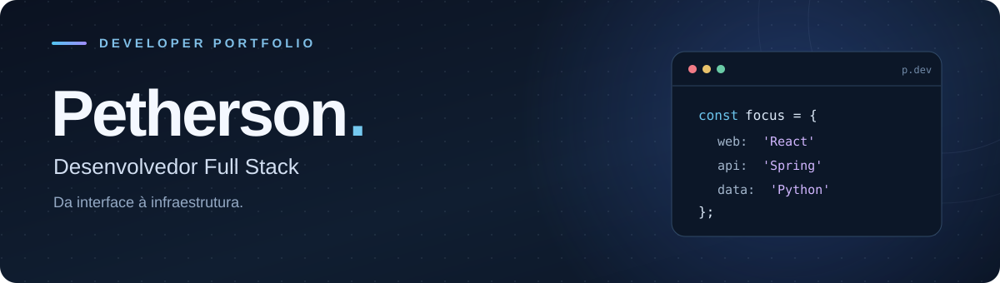

  

    

  
  &nbsp;&nbsp;
  
  &nbsp;&nbsp;
  
  &nbsp;&nbsp;
  
  &nbsp;&nbsp;
  

 

## Tecnologias e ferramentas

### Desenvolvimento de aplicações

  
  
  
  
  
  
  
  

  
  
  
  
  
  
  

### IA, dados e visão computacional

  
  
  
  
  
  
  
  
  

### Ferramentas e plataformas

  
  
  
  
  
  
  

  
  
  
  
  
  

### Design e edição

  
  
  
  
  

---

## Projetos em destaque

  
  &nbsp;&nbsp; <strong><a href="https://github.com/pethersonzada/bevans-frontend">BeVans</a></strong>
   
  &nbsp;&nbsp; <a href="https://github.com/pethersonzada/bevans-frontend">Mobile</a> · <a href="https://github.com/pethersonzada/bevans-backend">Backend</a> · <a href="https://github.com/pethersonzada/bevans-webapp">WebApp</a>

 

  
  &nbsp;&nbsp; <strong><a href="https://github.com/pethersonzada/rafaela-makeup">Rafaela Makeup</a></strong>
   
  &nbsp;&nbsp; Next.js · TypeScript

 

  
  &nbsp;&nbsp; <strong><a href="https://github.com/pethersonzada/face-capture">Face Capture</a></strong>
   
  &nbsp;&nbsp; Python · OpenCV

 

  
  &nbsp;&nbsp; <strong><a href="https://github.com/pethersonzada/oci-instance-hunter">OCI Instance Hunter</a></strong>
   
  &nbsp;&nbsp; Python · GitHub Actions

 

  
  &nbsp;&nbsp; <strong><a href="https://github.com/pethersonzada/client-data-analysis">Análise de Cancelamentos</a></strong>
   
  &nbsp;&nbsp; Pandas · Plotly

 

<a href="https://github.com/pethersonzada?tab=repositories">Ver todos os repositórios</a>
